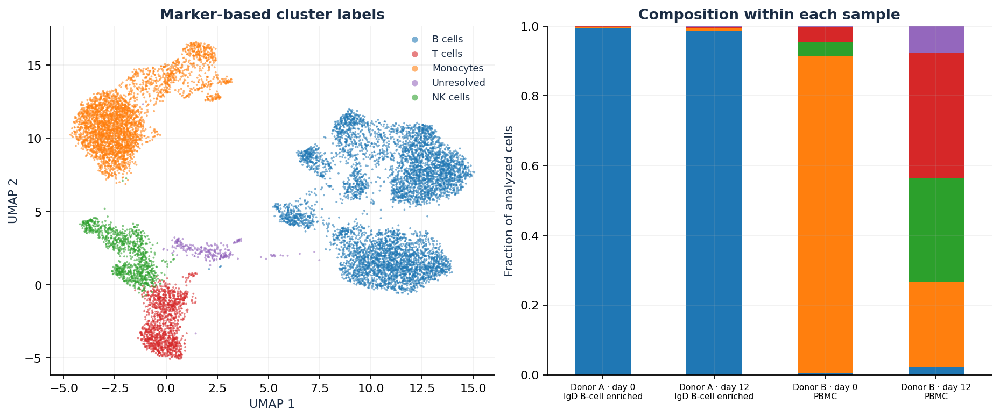

# Influenza single-cell atlas

**What transcriptomic cell populations appear before and after vaccination in four human blood libraries?**

Analyze four public PBMC libraries from GSE211865 with Scanpy. Compare days 0 and 12 within two donors and track the source library preparation.

## Results

The four libraries contained **128,369 input cells**. The balanced analysis sampled **12,000 QC-passing cells** and yielded **12 Leiden clusters**. Marker profiles supported labels for B cells, T cells, NK cells and monocytes, with unresolved cells retained. The two IgD-enriched libraries were overwhelmingly B-cell labeled, consistent with their preparation. See [per-library QC](results/qc.csv), [cell composition](results/composition.csv), [marker scores](results/cluster_marker_scores.csv) and the [notebook](analysis.ipynb).



## Methods

Read Cell Ranger filtered HDF5 gene expression counts. QC uses 300–6,500 detected genes, <20% mitochondrial reads and ≤45,000 total counts. Cap each sample at 3,000 cells using a fixed seed, normalize to 10,000 counts, log transform, select variable genes by sample and compute PCA, neighbors, Leiden clusters and UMAP. Add tentative labels by comparing cluster expression of fixed lineage markers.

## Reproduce

Use Python 3.12 in this repository.

```powershell
python -m venv .venv
.\.venv\Scripts\python -m pip install -r requirements.txt
.\.venv\Scripts\python analysis.py
.\.venv\Scripts\python -m unittest discover -v
```

On macOS and Linux, use `.venv/bin/python` in place of the Windows executable.
The analysis downloads public inputs into the ignored `raw/` cache.

The first run streams ranges from four compressed GEO archives. In total, the archives are about 4.1 GB. You can also place complete archives or the named HDF5 matrices in `raw/`. Subsequent runs use the verified HDF5 cache.

## Interpretation

The two donors have different enrichment protocols. Donor A's libraries were enriched for IgD B cells. Cluster markers offer provisional identities. With two donors and no confirmatory differential testing, comparisons are descriptive. Library composition can reflect sorting, sampling and QC.

## Sources and licenses

[NCBI GEO GSE211865](https://www.ncbi.nlm.nih.gov/geo/query/acc.cgi?acc=GSE211865) · [McIntire et al.](https://pubmed.ncbi.nlm.nih.gov/38935072/) · [Four library accessions and download locations](data/samples.csv)

Input URLs and hashes are recorded in [data/sources.json](data/sources.json). The MIT license applies to this repository's code. Original datasets, structures and external scores retain their source terms.
